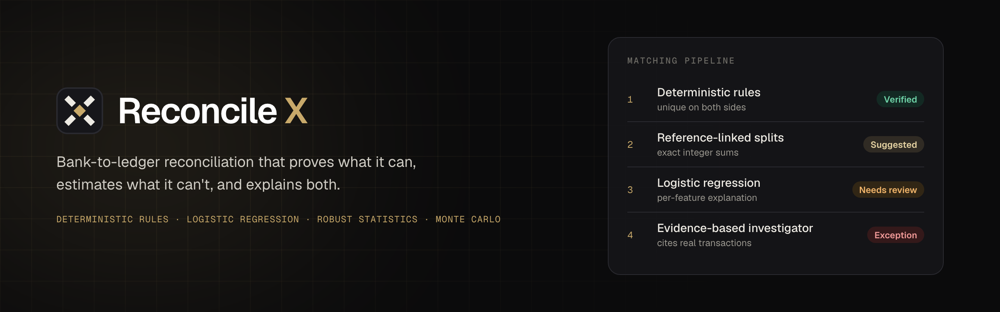
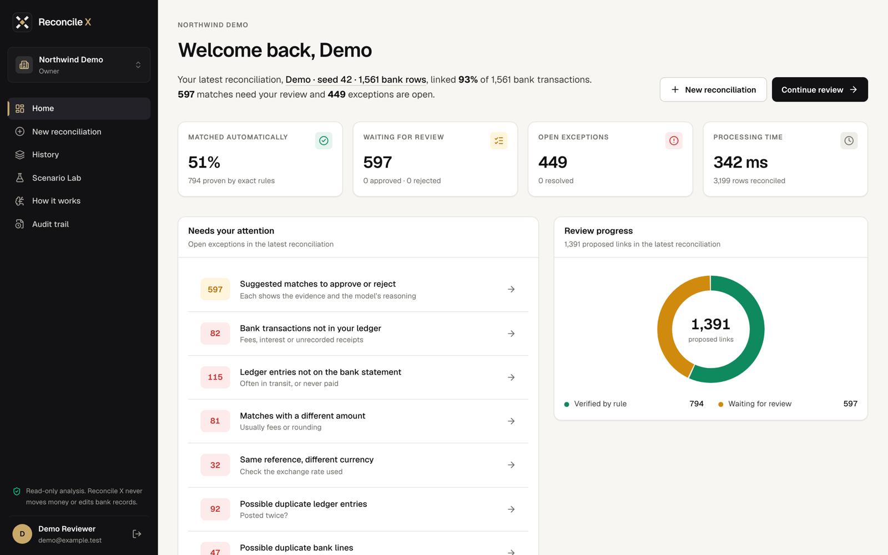
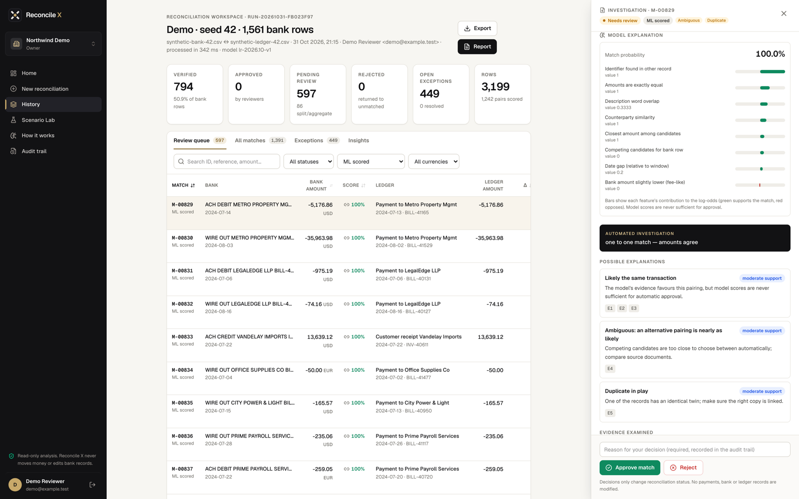
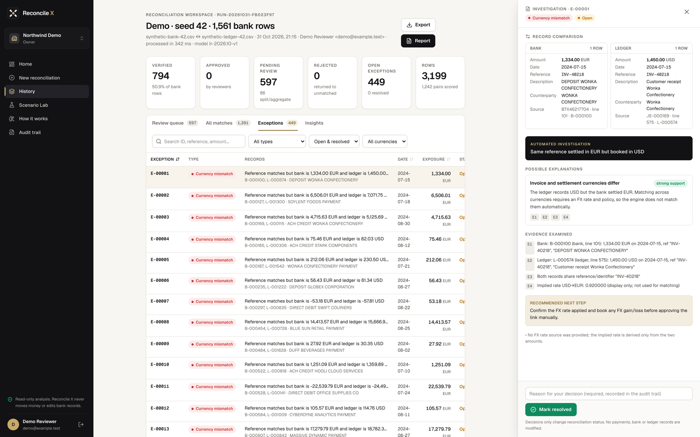
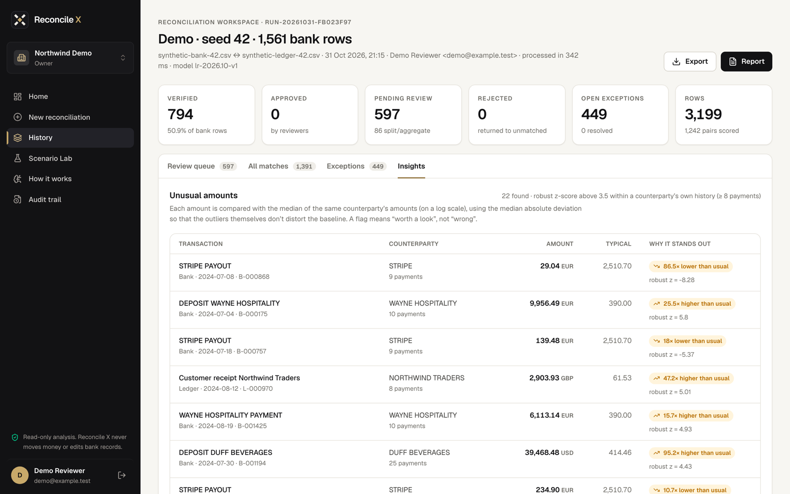
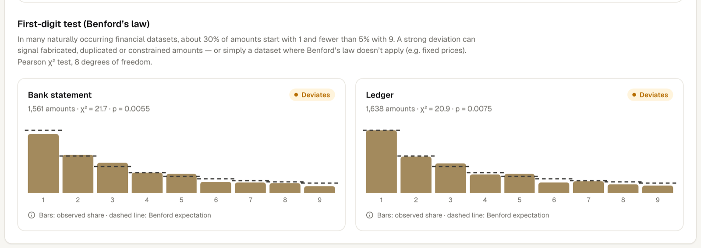
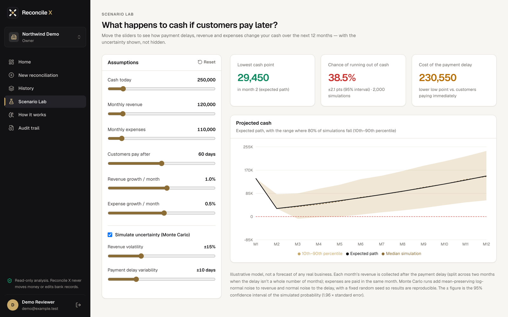
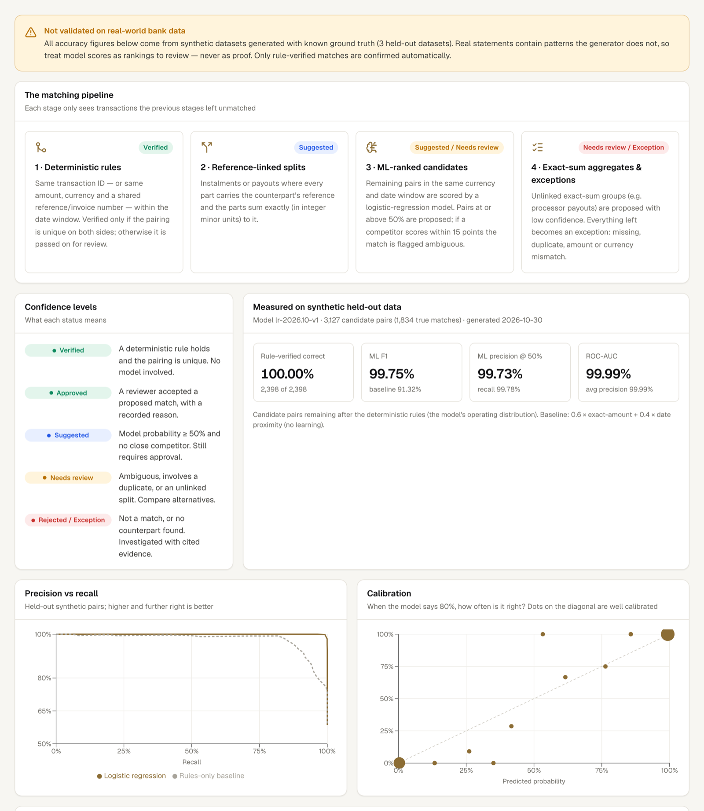
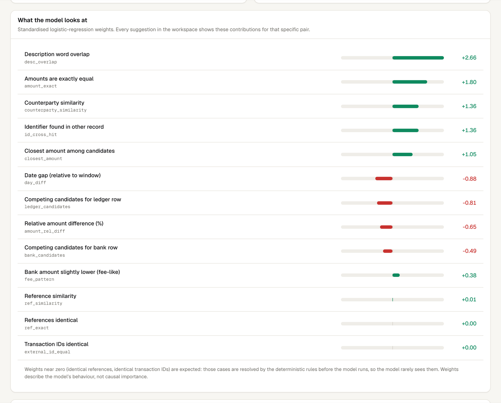
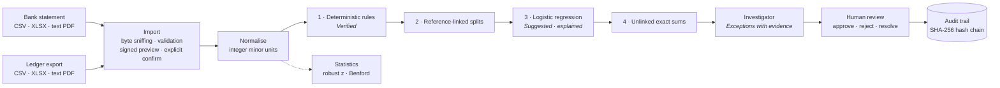

<p align="center">
  
</p>

<p align="center">
  <a href="docs/methodology.md"><b>Methodology</b></a> ·
  <a href="docs/walkthrough.md"><b>5-minute walkthrough</b></a> ·
  <a href="#getting-started"><b>Run it locally</b></a> ·
  <a href="#limitations"><b>Limitations</b></a>
</p>

Reconcile X matches a bank statement against a company's ledger, finds what doesn't match, investigates why, and lets a person approve the result, with every decision written to a tamper-evident audit trail. Around that core it adds statistical anomaly detection and a Monte Carlo cash-flow Scenario Lab.

> **Independent project by Talal Mohamed Talal Sarhan.** Every dataset in this repository and in the screenshots is **synthetic**. No real bank accounts, customers or statements were used, and no result here has been validated on real financial data.

---

## The problem

Every business with a bank account has to reconcile it: confirm that each line on the bank statement corresponds to an entry in the accounting ledger, and explain every line that doesn't. Much of this is still done by hand in spreadsheets. The hard cases are exactly where errors happen: a fee deducted from a payment, one invoice paid in three instalments, a card processor paying out several sales in one deposit, an entry posted twice.

Automating it raises a second problem, **trust**. A tool that silently "auto-matches" with a confidence score nobody can explain is not acceptable to an accountant or an auditor. Reconcile X is built around one rule: **only what can be proven is confirmed automatically; everything estimated is explained and goes to a person.**

<p align="center"></p>

## Which technique does what

The system deliberately mixes methods, and the interface labels each result by how it was produced.

| Stage | Technique | Learned from data? | Result | Needs a person? |
|---|---|---|---|---|
| Exact matches | **Deterministic rules** + uniqueness check on both sides | No | **Verified** | No |
| Instalments with a shared reference | **Deterministic** exact-sum search (integer cents) | No | Suggested | Yes |
| Remaining candidate pairs | **Machine learning**: L2-regularised logistic regression, 13 features | **Yes** (synthetic training data) | Suggested / Needs review, with a per-feature explanation | **Yes** |
| Unlinked payouts (e.g. card processors) | **Deterministic** bounded subset-sum search | No | Needs review | Yes |
| Everything left over | **Rule-based investigator** that must cite the underlying transactions | No | Exception with ranked hypotheses | Yes |
| Unusual amounts | **Robust statistics**: modified z-score (median / MAD) | No | Flag ("worth a look") | Yes |
| Dataset-level digit check | **Statistics**: Benford χ² goodness-of-fit test | No | Indicator only | n/a |
| Cash-flow what-ifs | **Simulation**: deterministic projection + seeded Monte Carlo | No | P10/P50/P90 bands, share of simulations with cash < 0 | n/a |

Nothing uncertain is ever approved automatically. Reconcile X never moves money or edits bank or ledger records.

---

## A tour (synthetic demo data)

### Review queue: machine-learning suggestions with their reasons
Each model suggestion shows the model-estimated match score (labelled "Match probability" in the app; it is the model's output, not a real-world probability) and every feature's contribution to the log-odds (green supports the match, red opposes it). Competing candidates scoring within 0.15 are flagged as ambiguous, and duplicates are called out.

<p align="center"></p>

### Exceptions: an investigator that has to show its evidence
For each unmatched or inconsistent item, a rule-based investigator searches the whole dataset (same amount outside the window, same reference at a different amount or currency, duplicates, statement-period edges) and ranks hypotheses by support. Every hypothesis cites evidence items, and every evidence item cites underlying transaction IDs; the code throws if it doesn't.

<p align="center"></p>

### Anomaly detection: robust statistics, no training
Amounts are compared with the same counterparty's own history on a log scale using the median and median absolute deviation, so the outliers being searched for don't distort the baseline.

<p align="center"></p>

A Benford first-digit test runs on each side as a dataset-level indicator. The synthetic demo data **deviates**, as it should: about 15% of its amounts are deliberately round numbers.

<p align="center"></p>

### Scenario Lab: Monte Carlo cash-flow simulation
"What happens to cash if customers pay 60 days later?" A deterministic projection is shown with the band where 80% of 2,000 seeded simulations fall, and the share of simulations in which cash runs out. Its ±95% interval describes simulation sampling uncertainty only (how precisely 2,000 runs estimate that share under the chosen assumptions), not how certain the forecast is in the real world. The inputs are illustrative, not a forecast of any real business.

<p align="center"></p>

### How it works: the model, in the open
The app publishes the matching pipeline, the model's held-out synthetic evaluation, its calibration, and its actual weights, under a notice that none of it has been validated on real bank data.

<p align="center"></p>
<p align="center"></p>

---

## Architecture



Each stage only sees what the previous stages left unmatched, which is also the distribution the model is trained on.

| Layer | Where | What |
|---|---|---|
| Engine | `src/engine/` | Pure TypeScript: money, dates, text similarity, candidate generation, rules, model, splits, investigator, anomaly statistics, scenario model, synthetic data generator, evaluation |
| Server | `src/server/` | SQLite (better-sqlite3), Better Auth with organisations, workspace-scoped repository, audit chain, statement import, reports |
| App | `src/app/` | Next.js 15 App Router pages and API routes |
| Tests | `tests/` | 148 Vitest unit and integration tests |
| Scripts | `scripts/` | Model training, anomaly evaluation, migrations, verified backups, a live security smoke test |

### Engineering decisions worth noting
- **Money is exact.** Amounts are integer minor units (`bigint`) with ISO 4217 exponents. A strict parser **rejects** ambiguous input (`10.005 USD`, malformed separators, a debit and a credit on one row) instead of rounding. Floating point is used only for statistics and the Scenario Lab, never for matching or totals.
- **Missing data is not evidence.** An empty field is mean-imputed (contributes zero after standardisation) instead of being read as "dissimilar".
- **Uniqueness before confidence.** A rule match is verified only if the pairing is degree-1 on both sides of the bipartite candidate graph; two identical ledger entries competing for one bank line go to review.
- **Imports are defensive.** File type comes from the bytes, not the extension. `.xlsx` is checked for zip bombs and macros, and legacy `.xls` and scanned PDFs are rejected with a plain explanation. PDF tables are rebuilt from text positions, assigning a value to a column only when it overlaps *and* aligns with the header; anything ambiguous is flagged, never guessed. Previews are HMAC-signed and bound to the workspace, user, statement side, file hash and exact rows for 30 minutes, so an amount can't change between preview and save.
- **Tenant isolation is checked on every request.** Every workspace page and data API route verifies the session *and* re-checks membership in the database; every query is scoped to the workspace. A 69-check smoke test exercises this against a live server.
- **The audit trail is tamper-evident.** It is append-only (database triggers block edits and deletes) and SHA-256 hash-chained per workspace, with a verify button in the app.

---

## Machine-learning methodology

**Task.** Binary classification of a (bank row, ledger row) candidate pair as the same transaction or not, used to *rank* pairs for human review, never to approve them.

**Features (13).** Exact-amount indicator · relative amount difference (%) · date gap relative to the window · Jaro–Winkler similarity of references · identical-reference indicator · identifier found in the other record · Jaccard overlap of description words · Jaro–Winkler similarity of counterparties · identical transaction ID · log(1 + competing candidates) for the bank row and for the ledger row · closest amount among candidates · fee-like pattern (bank slightly lower, ≤ 3%).

**Model.** Standardise each feature, $z_j = (x_j - \mu_j)/\sigma_j$, then

$$P(\text{match}\mid x) = \sigma\Big(\beta_0 + \sum_j \beta_j z_j\Big)$$

fitted by minimising L2-regularised log loss ($\lambda = 10^{-3}$) with full-batch gradient descent (1,500 epochs, learning rate 0.3, zero initialisation, fully deterministic). The output is a model-estimated match score between 0 and 1. Its calibration was measured only on synthetic held-out data, so it should not be read as a real-world probability.

**Why logistic regression.** It is the simplest model whose output is a score between 0 and 1 and whose prediction decomposes *exactly* into per-feature contributions $\beta_j z_j$. That decomposition is what the review screen shows. A tree ensemble might score higher, but it could not be explained to a reviewer as directly.

**Training data.** Pairs that remain after the deterministic rules and the linked-split pass (the model's real operating distribution), from synthetic seeds 1–8. Evaluation uses held-out seeds 101–103. Labels come from the generator's ground truth.

**Largest learned weights** (standardised): description word overlap **+2.66**, exact amount **+1.80**, counterparty similarity **+1.36**, identifier cross-hit **+1.36**, closest amount **+1.05**; date gap **−0.88**, competing ledger candidates **−0.81**, relative amount difference **−0.65**. Identical references and transaction IDs have weights near zero *by construction*: those cases are resolved by the rules before the model ever sees them.

Full derivations, the split search and the investigator are in **[docs/methodology.md](docs/methodology.md)**.

## Statistics and simulation

- **Unusual amounts:** $z = 0.6745\,(x - \tilde{x}) / \mathrm{MAD}$ on $x = \ln|\text{amount}|$, within each counterparty with at least 8 transactions; $|z| > 3.5$ is flagged (Iglewicz & Hoaglin). If MAD = 0, the mean absolute deviation is used instead.
- **Benford's law:** Pearson $\chi^2$ with 8 degrees of freedom; the p-value is computed numerically from the regularised upper incomplete gamma function and checked against standard table values. At least 100 amounts are required.
- **Scenario Lab:** revenue invoiced in a month is collected after the payment delay (split across two months when the delay isn't a whole number of months). Each of 2,000 seeded Monte Carlo runs multiplies monthly revenue by a mean-preserving log-normal factor and draws the delay from a truncated normal. Reported: P10/P50/P90 cash per month and $\hat p$ = share of runs with cash < 0 in any month, with $SE = \sqrt{\hat p(1-\hat p)/N}$. That standard error measures Monte Carlo sampling error under the chosen assumptions; it says nothing about whether the assumptions match reality. With zero uncertainty the simulation collapses exactly onto the deterministic path (tested).

---

## Results (synthetic benchmarks only)

All figures come from committed evaluation artifacts (`src/engine/model/evaluation.json`, `anomaly-evaluation.json`) produced by `npm run train` and `npm run eval:anomaly`. They are measured on **synthetic data with known ground truth**. They show the pipeline behaves as designed; they are **not** evidence of accuracy on real bank statements.

**Matching**: 3 held-out synthetic datasets, ~3,150 rows each, 3,127 candidate pairs.

| | Model (logistic regression) | Rules-only baseline |
|---|---|---|
| ROC-AUC | 99.99% | 96.42% |
| Precision @ 0.5 | 99.73% | 96.54% |
| Recall @ 0.5 | 99.78% | 86.64% |
| F1 | **99.75%** | 91.32% |

The baseline is a fixed score (0.6 × exact amount + 0.4 × date proximity) with no learning.

| End-to-end on the held-out datasets | Result |
|---|---|
| Rule-verified matches that were correct | 2,398 / 2,398 |
| ML suggestions that were correct | 1,440 / 1,440 |
| Split / aggregate groups found exactly | 276 of 278 |
| Time to reconcile ~3,150 rows | ≈ 0.3 s on a laptop |

**Anomaly detection**: 12,000 synthetic transactions with 349 injected anomalies (10 seeds).

| Threshold | Precision | Recall | F1 |
|---|---|---|---|
| 3.0 | 77.4% | 100% | 87.3% |
| **3.5 (published default)** | **90.6%** | **99.1%** | **94.7%** |
| 4.0 | 96.1% | 98.6% | 97.3% |

On this benchmark 4.0 scores a higher F1. I kept the conventional 3.5: tuning a threshold to a benchmark I generated myself would be fitting my own assumptions.

## Limitations

- **Synthetic evaluation only.** I wrote the data generator, so the patterns the model learns (fees, typos, delays, splits) are patterns I put there. The high scores show the system works as designed on a well-specified problem; real statements contain formats, narratives and error types the generator doesn't. This is why only rule-verified matches are confirmed automatically.
- **Linear model.** Logistic regression can't express every interaction (e.g. "same invoice number but only 40% of the amount"); known cases like that are handled by a structural rule for reference-linked splits instead.
- **Fixed thresholds.** The 0.5 score threshold for suggestions and the 0.15 ambiguity margin are defaults, not tuned to any real organisation's data.
- **Benford's law** doesn't apply to every dataset (fixed prices, round amounts); it is shown as an indicator, never as a finding.
- **Anomaly benchmark** matches the detector's assumptions (stable spending per counterparty), so its scores are optimistic.
- **Scenario Lab** is illustrative: floating-point whole units, fixed expense timing, independent monthly shocks.
- **Product scope.** Text-based PDF statements with a clear header row only (no OCR). No email delivery (password reset, invitations), no role-based approval limits, single-node SQLite.

---

## Getting started

Developed and tested with Node.js 24 on macOS.

```bash
npm install
cp .env.example .env.local            # then set BETTER_AUTH_SECRET (the file shows a generator command)
npm run db:migrate                    # creates the local SQLite database in ./data
npm run dev -- -p 3001 -H 127.0.0.1   # http://127.0.0.1:3001 (matches BETTER_AUTH_URL in .env.example)
```

Recent npm versions may warn that install scripts for `better-sqlite3`, `esbuild` and similar packages were not run. That is expected: they ship prebuilt binaries and work without those scripts.

Sign up, create a workspace and choose **Explore with demo data**, or download the synthetic sample statement (PDF / Excel) and ledger (CSV) from *New reconciliation* and upload them.

### Tests and reproducing the numbers

```bash
npm test                 # 148 unit and integration tests
npm run typecheck && npm run lint
npm run train            # retrain the model; regenerates src/engine/model/weights.json + evaluation.json
npm run eval:anomaly     # re-measure the anomaly detector
npm run test:security -- http://127.0.0.1:3002   # live auth/isolation checks: run ONLY against a test server with its own database
```

## Repository map

```
src/engine/        matching, ML model, anomaly statistics, scenario model, synthetic data, evaluation (pure TypeScript)
src/server/        database, auth, workspace-scoped repository, audit chain, statement import, reports
src/app/           pages (marketing site, auth, workspace) and API routes
tests/             Vitest suites
scripts/           training, evaluation, migrations, verified backups, security smoke test
docs/              methodology, walkthrough, screenshots
```

## What I learned

When I Started Working on building Reconcile X i honestly didn't know where to begin and  I genuinely underestimated how much deep research it would take. I had plenty of ideas but i was confused executing by understanding the financial side and figuring out the financial concepts, reconcile, numbers, and different approaches on how would everything work together and that was harder then i initially expected it to be. I felt completely lost in some moments then ended up going back to my MIT courses notes on AI Finance and just getting a quick memory of the information again briefly afterward i was slowly able to connect the dots to what i was working on building. In summary what i learned, is that sometimes when you understand something in theory is one thing while actually using that knowledge to solve a problem and executing to be able to solve problem is something entirely different.

## Author

**Talal Mohamed Talal Sarhan**: design, implementation and evaluation.

### References
- Iglewicz, B. & Hoaglin, D. (1993). *How to Detect and Handle Outliers*. ASQC Quality Press.
- Nigrini, M. (2012). *Benford's Law: Applications for Forensic Accounting, Auditing, and Fraud Detection*. Wiley.
- Winkler, W. (1990). String comparator metrics and enhanced decision rules in the Fellegi–Sunter model of record linkage.
- Press, W. et al. *Numerical Recipes*, incomplete gamma function evaluation.
